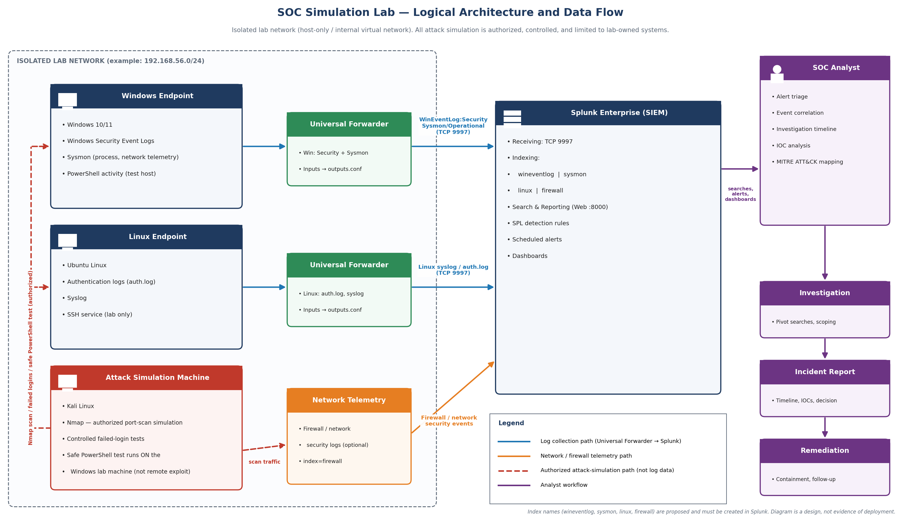
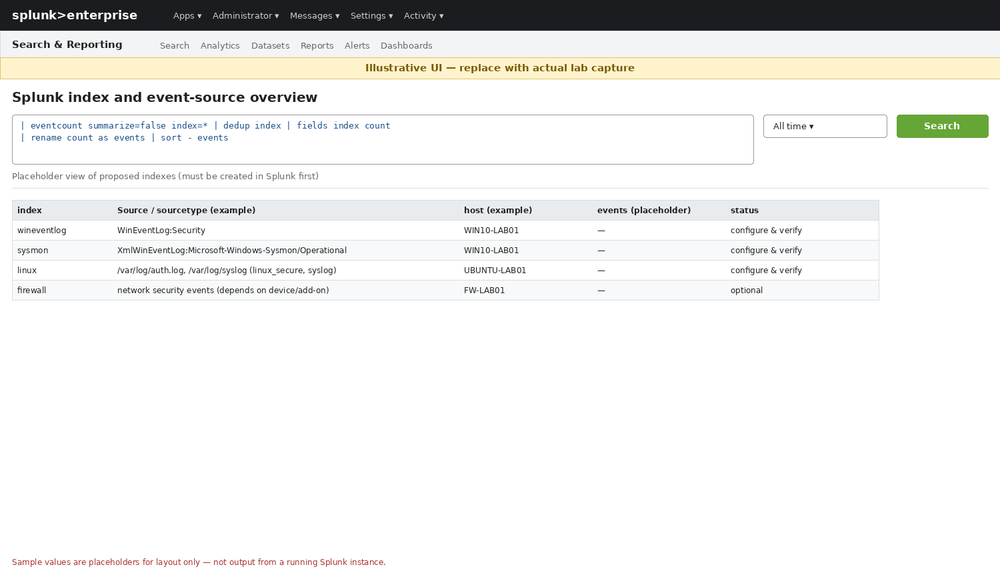
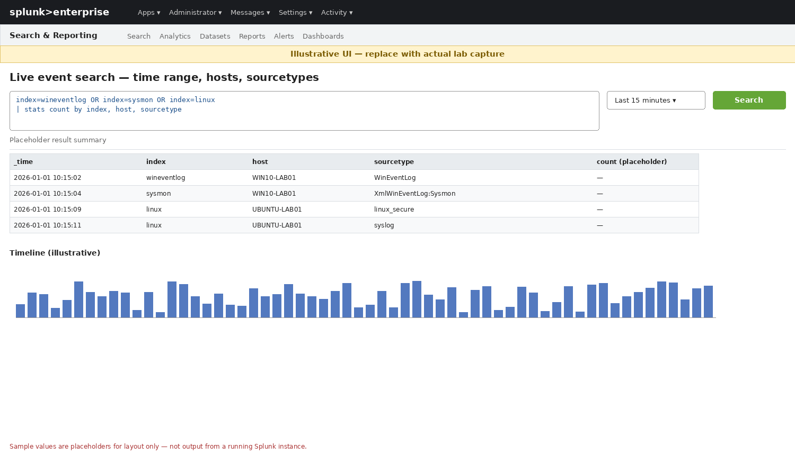
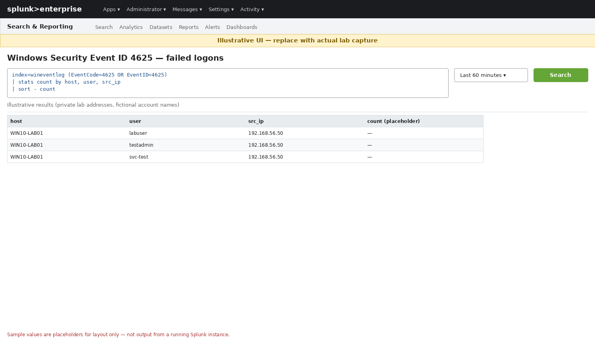
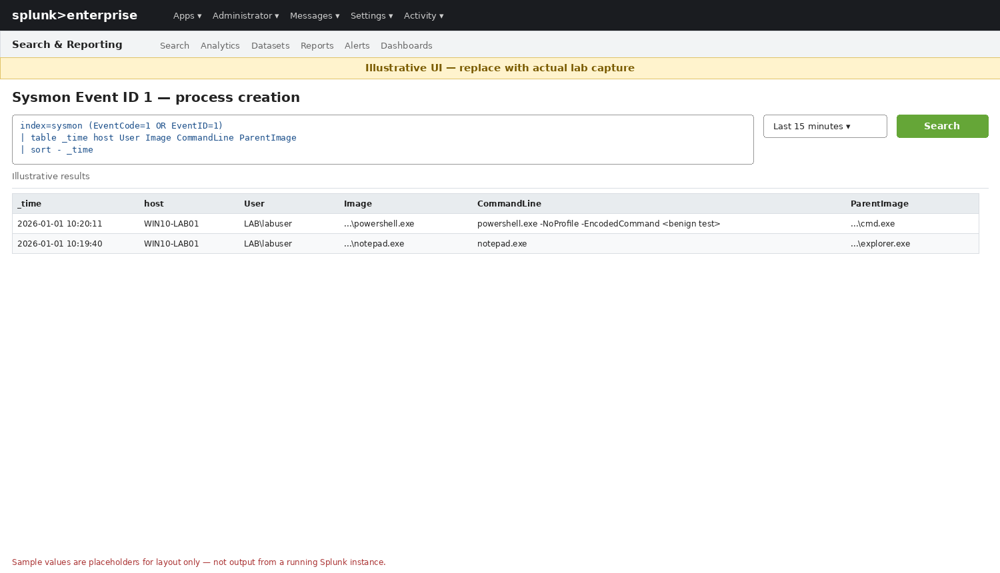
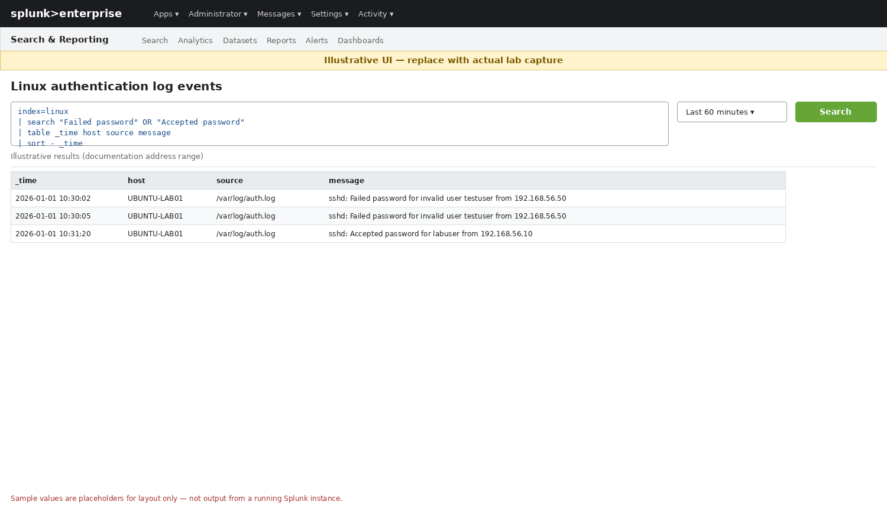
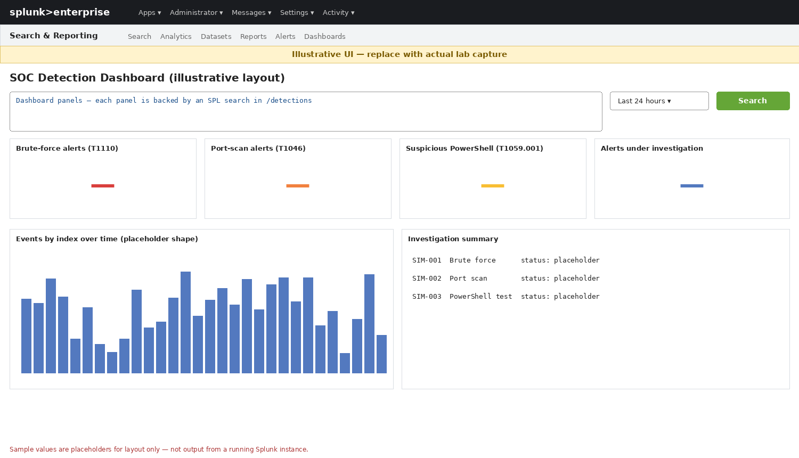

# SOC Simulation Lab: Threat Detection and Incident Investigation Using Splunk

A SOC home-lab project: forward Windows and Linux telemetry to **Splunk Enterprise**, write **SPL detections** mapped to **MITRE ATT&CK**, generate authorized test activity from Kali Linux, and document investigations as incident reports.

> **Project status:** design, detection content and documentation are complete. Deployment and validation are tracked in [`docs/validation-checklist.md`](docs/validation-checklist.md). Items are ticked only when actually performed. SPL here is **draft until tested** against real lab data. Mockup images are **illustrative**, not real captures.



## Table of Contents
1. [Objectives](#1-project-objectives) · 2. [Architecture](#2-architecture-and-data-flow) · 3. [Tools](#3-tools-and-technologies) · 4. [Index design](#4-splunk-index-design) · 5. [Detections](#5-detection-use-cases-and-spl) · 6. [Screenshots](#6-live-event-capture-screenshots) · 7. [Investigation](#7-incident-investigation-workflow) · 8. [ATT&CK](#8-mitre-attck-mapping) · 9. [Install](#9-installation-and-configuration) · 10. [Validation](#10-testing-and-validation) · 11. [Limitations](#11-limitations-and-future-improvements) · [Contributors](#contributors) · 12. [Resume text](#12-resume-ready-description)

## 1. Project Objectives
- Centralize Windows, Sysmon, Linux and network telemetry in a SIEM.
- Build and document detections for brute force, network service discovery and suspicious PowerShell.
- Practice triage: correlate events, build timelines, identify IOCs, map to ATT&CK.
- Produce incident reports and remediation recommendations.
- Distinguish **suspicious activity** from **confirmed compromise**.

## 2. Architecture and Data Flow
Full detail: [`docs/architecture.md`](docs/architecture.md).

| Path | Flow |
|---|---|
| Windows | Security log + Sysmon → Universal Forwarder → Splunk (TCP 9997) |
| Linux | auth.log / syslog → Universal Forwarder → Splunk (TCP 9997) |
| Network | Firewall/network security events → Splunk |
| Attack simulation | Kali → (Nmap, failed logins, safe PowerShell test on Windows host) → **appears as endpoint/network telemetry** |
| Analyst | Splunk searches, alerts, dashboards → investigation → incident report |

Blue arrows in the diagram are log collection; red dashed arrows are authorized attack simulation (not log data).

## 3. Tools and Technologies
| Tool | Purpose |
|---|---|
| Splunk Enterprise | SIEM: index, search, alert, dashboard |
| Splunk Universal Forwarder | Log shipping from endpoints |
| Sysmon | Endpoint process/network telemetry |
| Windows Event Logs | Authentication and system events |
| Linux syslog / auth.log | Linux authentication and system events |
| Kali Linux (Nmap) | Authorized test activity |
| SPL | Detection queries |
| MITRE ATT&CK | Technique mapping |

## 4. Splunk Index Design
These are **proposed names**; create and configure them in Splunk first (see [`configs/README.md`](configs/README.md)).

| Index | Content |
|---|---|
| `wineventlog` | Windows Security events |
| `sysmon` | Sysmon endpoint telemetry |
| `linux` | Linux authentication and system logs |
| `firewall` | Firewall / network security events |

Field names (`user`, `src_ip`, `EventCode`, `Image`, `CommandLine`, ...) and sourcetypes depend on the add-ons and configuration in use. Confirm with `| fieldsummary` and adjust queries. **These searches are untested until run against corresponding data.**

## 5. Detection Use Cases and SPL
Files in [`detections/`](detections/). All are drafts.

**Baseline searches**
```spl
index=wineventlog (EventCode=4625 OR EventID=4625)
| stats count by host, user, src_ip
| sort - count
```
```spl
index=sysmon (EventCode=1 OR EventID=1)
| table _time host User Image CommandLine ParentImage
| sort - _time
```
```spl
index=linux
| search "Failed password" OR "Accepted password"
| table _time host source message
| sort - _time
```
```spl
index=firewall
| bin _time span=1m
| stats dc(dest_port) as unique_ports count by _time src_ip dest_ip
| where unique_ports >= 15
| sort - unique_ports
```

### 5.1 Brute-force attempts — T1110 (`detections/brute-force.spl`)
| Item | Detail |
|---|---|
| Objective | Find repeated authentication failures from one source |
| Telemetry | Windows 4625 (`wineventlog`); sshd "Failed password" (`linux`) |
| SPL | `index=wineventlog EventCode=4625 \| bin _time span=5m \| stats count as failures dc(user) as accounts by _time host src_ip \| where failures >= 10` (full variants in file) |
| Expected result | A row per source/host/5-min window exceeding the threshold during a controlled failed-login test |
| False positives | Mistyped passwords, expired service-account credentials, scripts with stale passwords, vulnerability scanners |
| Investigation | Identify source; check if it is a known/authorized host; look for 4624 from the same source after failures; check targeted accounts (single vs many); review activity after any success |
| ATT&CK | Credential Access — T1110 Brute Force |
| Remediation | Lockout/throttling policy, MFA, restrict exposed services (RDP/SSH), block abusive source, reset credentials if a success followed |

### 5.2 Network service discovery — T1046 (`detections/possible-port-scan.spl`)
| Item | Detail |
|---|---|
| Objective | Detect one source touching many ports/hosts quickly |
| Telemetry | Network/firewall connection logs with `src_ip`, `dest_ip`, `dest_port` |
| SPL | Baseline search above (≥15 unique ports/min) |
| Expected result | The Kali address listed with unique-port count during an `nmap` test |
| False positives | Vulnerability scanners, monitoring tools, load balancers, backup/discovery software |
| Investigation | Confirm source ownership; check ports targeted; check follow-up connections or logons from the same source; compare with change/scan schedules |
| ATT&CK | Discovery — T1046 Network Service Discovery |
| Remediation | Segment network, restrict exposed services, rate-limit/block source, allow-list approved scanners |

### 5.3 Suspicious PowerShell — T1059.001 (`detections/suspicious-powershell.spl`)
| Item | Detail |
|---|---|
| Objective | Flag PowerShell launched with common obfuscation/download/hidden-window patterns |
| Telemetry | Sysmon Event ID 1 (optionally Script Block Logging 4104) |
| SPL | Sysmon EID 1 where `Image` is powershell/pwsh and `CommandLine` contains `-EncodedCommand`, `DownloadString`, `IEX`, hidden window, etc. |
| Expected result | The benign encoded test command from [`docs/setup-guide.md`](docs/setup-guide.md) shows in results |
| False positives | Admin scripts, software deployment, management agents, legitimate encoded commands |
| Investigation | Decode the command; review `ParentImage` and user; look for network connections and child processes in Sysmon; check script block logs |
| ATT&CK | Execution — T1059.001 PowerShell |
| Remediation | Constrained Language Mode, script block logging, application control, restrict PowerShell for standard users, isolate host if malicious |

> **Suspicious ≠ compromised.** An alert is a lead. Compromise is established only with corroborating evidence (e.g. successful logon from an unexpected source plus anomalous post-logon activity).

## 6. Live Event-Capture Screenshots
> **Illustrative UI — replace with actual lab capture.** The images below are generated mockups, **not** screenshots from a running Splunk instance. Capture instructions: [`assets/screenshots/README.md`](assets/screenshots/README.md).

| | |
|---|---|
|  |  |
|  |  |
|  |  |

1 Index overview · 2 Live search · 3 Event 4625 · 4 Sysmon EID 1 · 5 Linux auth · 6 Dashboard

## 7. Incident Investigation Workflow
1. **Triage** the alert: what fired, when, which host/source.
2. **Scope** with pivot searches on host, user and `src_ip`.
3. **Correlate** across indexes (Windows, Sysmon, Linux, firewall).
4. **Timeline** the events and extract **IOCs**.
5. **Map** to ATT&CK, state confidence.
6. **Decide**: close, monitor, escalate or contain.
7. **Report** and recommend remediation.

Templates: [`incident-report-template.md`](incident-reports/incident-report-template.md) · Training example: [`simulated-incident.md`](incident-reports/simulated-incident.md) (**SIMULATED — NOT A REAL INCIDENT**).

## 8. MITRE ATT&CK Mapping
| Detection | Tactic | Technique | Index |
|---|---|---|---|
| Brute force | Credential Access | T1110 | wineventlog, linux |
| Port scan | Discovery | T1046 | firewall |
| Suspicious PowerShell | Execution | T1059.001 | sysmon |

## 9. Installation and Configuration
Step by step: [`docs/setup-guide.md`](docs/setup-guide.md). Config snippets (examples, untested): [`configs/README.md`](configs/README.md).

**Safety:** isolated lab network, systems you own, benign tests only, snapshot VMs, never attack third-party systems.

Optional logic test with fabricated events:
```bash
python3 scripts/generate-synthetic-events.py --out sample-data
```

## 10. Testing and Validation
Use [`docs/validation-checklist.md`](docs/validation-checklist.md). No detection accuracy figures are claimed; results are reported only after real lab tests.

## 11. Limitations and Future Improvements
**Limitations**
- Small isolated lab; no production traffic or realistic baseline.
- Static thresholds; false-positive rates unmeasured.
- Port-scan detection depends on having network/firewall telemetry with the expected fields.
- Mockups are illustrative until replaced.

**Future work**
- Convert detections to scheduled alerts with throttling and notable-event fields.
- Add Windows Firewall / Zeek / Suricata data to `firewall`.
- CIM data-model mapping; risk-based alerting.
- Additional ATT&CK coverage (persistence, lateral movement); Sigma rule conversion.
- Measure detection results against repeatable test cases.

## Contributors
Replace the placeholders with your GitHub usernames and the parts each person actually worked on.

| Contributor | GitHub | Areas owned |
|---|---|---|
| Amaanali Motiwala | [@AmaanaliMotiwala0109](https://github.com/AmaanaliMotiwala0109) | e.g. Splunk server, Windows + Sysmon forwarder, brute-force and PowerShell detections |
| Vedant Patel | [@Vedantp29](https://github.com/Vedantp29) | e.g. Linux forwarder, Kali tests, port-scan detection, dashboard |

Workflow: see [`CONTRIBUTING.md`](CONTRIBUTING.md) (branches + pull requests with peer review).

## 12. Resume-Ready Description
Use **only after** the corresponding work is done and verified. Replace each N with the true count.

**SOC Simulation Lab: Threat Detection using Splunk** | Splunk, Sysmon, Windows Event Logs, Kali Linux, MITRE ATT&CK
- Built a SOC lab forwarding Windows and Linux logs to Splunk via Universal Forwarders, with Sysmon for endpoint visibility.
- Wrote N custom SPL detections for brute force (T1110), port scanning (T1046) and suspicious PowerShell (T1059.001), mapped to MITRE ATT&CK.
- Investigated N simulated attacks and documented incident reports with timelines, IOCs and remediation.

Honesty notes: this repo contains 3 detection files; "alerts" is accurate only once you create saved alerts; "investigated N attacks" requires N completed reports from real lab runs.
